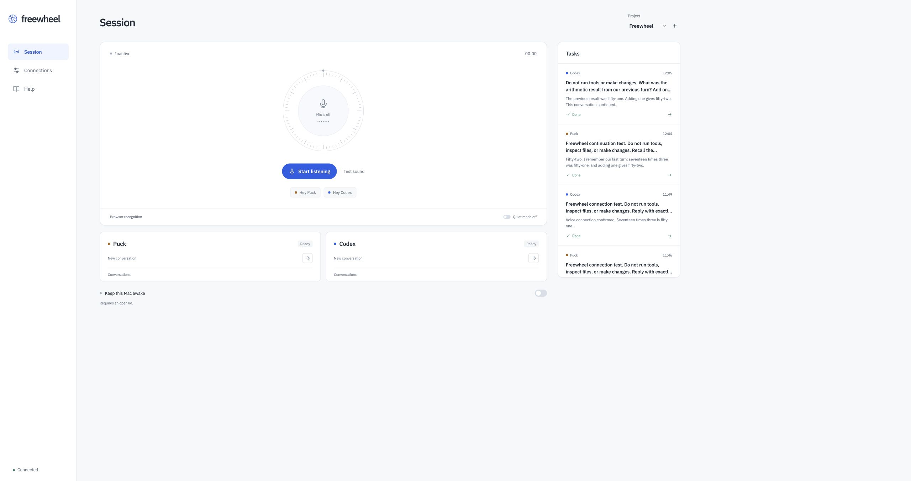

# Freewheel

Talk to Amp and Codex while your hands are occupied. Give either agent a task, hear a short result, and save the details for later.

Freewheel runs on your Mac: a small local companion controls your coding agents and serves the browser interface. It is not a hosted service. **No OpenAI API key is required for the default setup.**



## Start

Requires macOS, Node.js 22+, Chrome, an installed [Amp CLI](https://ampcode.com/docs), and access to Codex through your ChatGPT account. A compatible Codex CLI is pinned as a project dependency; your global installation is left alone.

```sh
git clone https://github.com/PriyanshLakhotia/freewheel.git
cd freewheel
npm ci
npx --no-install codex login  # only if this Mac is not already signed in
amp login                   # only if needed; an Amp token also works in the app
npm run build
npm start
```

Open **http://127.0.0.1:4318 in Chrome**. On later runs, double-click `Freewheel.command` or run `npm start`. Keep the Terminal process open. Control-C quits the companion and stops work that it is running.

1. In **Connections**, check that both agents are connected. Existing CLI logins are used automatically. An optional Amp access token applies until the companion quits.
2. On **Session**, add the absolute folder path of your project and select it. New conversations run in that directory.
3. Connect your earphones. Choose their microphone and output in macOS Sound settings. Use **Test sound**.
4. Enable **Keep this Mac awake** if needed. Keep the lid open: this control does not defeat lid-close sleep.
5. Press **Start listening** and allow microphone access. First try the full interaction while stationary.

## Talk

> “Hey Codex.” → “Codex. Go ahead.” → “Investigate the failing checkout tests.” → task read-back → “Send it.”

Use **“Hey Puck”** for Amp. With browser recognition you can also include a command in the same utterance as the wake phrase. With offline recognition or optional cloud transcription, pause after the wake phrase and wait for “go ahead.”

| Say                            | Result                                                                       |
| ------------------------------ | ---------------------------------------------------------------------------- |
| “Hey Codex, status”            | Hear which agents are working or waiting.                                    |
| “Send it” / “Cancel”           | Send or discard the task just read back.                                     |
| “Say that again”               | Repeat the last spoken update.                                               |
| “Stop working”                 | Interrupt the addressed agent.                                               |
| “New task”                     | Begin a fresh conversation on that agent's channel.                          |
| “Approve three” / “Deny three” | Answer that numbered Codex permission request.                               |
| “Quiet” / “Speak again”        | Hold or resume completion announcements. Requests for attention still speak. |

For 10 seconds after a reply, you can continue with the same agent without another wake phrase. The window is configurable. Each channel remembers its selected conversation; use “new task” to start fresh. Amp and Codex can each run one task concurrently. Both work in the selected folder, so avoid asking them to edit the same files at once.

Agents are instructed to lead with a spoken briefing of at most 55 words. Playback is bounded, and full output remains in task details. **Stop listening** releases the microphone but lets agent tasks finish. **Stop task** cancels a task. Recognition pauses during speech playback to avoid feedback; voice interruption during playback is not supported, and the **Stop speaking** button is available.

The typed composer, conversation picker, task details, follow-ups, and permission cards work without starting a voice session. Resume only idle conversations. For Codex, select their original project folder and finish any turn running in the desktop app first.

## Audio choices and cost

| Configuration                                           | Separate audio API charge | Tradeoff                                                                                                 |
| ------------------------------------------------------- | ------------------------- | -------------------------------------------------------------------------------------------------------- |
| Browser recognition + system voice (default)            | None from Freewheel       | Chrome's speech service may receive microphone audio. Network and browser lifecycle affect availability. |
| Vosk on this Mac + system voice                         | None                      | One-time ~40 MB model download. English only; technical dictation is less accurate.                      |
| Optional OpenAI command transcription and/or Nova voice | Usage based               | An OpenAI API key with separate billing is required. You can enable either independently.                |

Install the offline model in Connections, then use **Check offline recognition** to run synthetic wake-phrase and ordinary-speech checks without opening the microphone. The offline model remains outside the repository. Choosing offline listening keeps that recognition on your Mac; agents still need internet. If you enable cloud transcription, recorded commands go to OpenAI after the wake phrase.

For paid audio, Freewheel uses `gpt-4o-mini-transcribe` at **$0.003 per recorded minute** and `tts-1` at **$15 per million spoken characters**. An hour containing 15 minutes of dictated commands and 9,000 spoken characters would cost about **$0.18** for audio. Twenty such hours would be about **$3.60**. Duration alone does not determine cost; idle listening is not sent to the paid OpenAI endpoint. Prices checked 19 October 2026; see [OpenAI pricing](https://developers.openai.com/api/docs/pricing).

Codex coding uses the existing login and the account's normal usage limits. Amp uses its account's plan, routing and credits; Freewheel does not turn either into unlimited usage. See [Codex app-server authentication](https://developers.openai.com/codex/app-server) and [Amp pricing](https://ampcode.com/docs/pricing). The optional audio API is separate from ChatGPT billing.

The app defaults to a $2 estimated audio budget per companion process. It reserves estimated spend before requests, including failed requests conservatively. This is an application-side guard, not a provider billing cap. Spend resets when the companion restarts.

## Integration boundaries

- **“Puck” is the wake name for the Amp coding agent.** This does not control Amp's built-in Puck management assistant. The documented public API does not expose that conversation endpoint; Freewheel uses Amp's supported execute/continuation CLI.
- **Codex runs through a local `codex app-server` process.** It can create and resume saved local conversations; it does not click or send messages through the Codex desktop UI. It cannot reliably arbitrate concurrent work started in another app, so do not run the same conversation in two places.
- Codex uses workspace-write sandboxing with on-request approvals. Numbered command/file requests can be answered by voice. Additional permission scopes and unsupported prompts are declined, with an explanation. Amp's noninteractive execution can block on permissions; review those tasks in Amp. No allow-all flag is enabled.
- A web tab cannot guarantee background operation through screen locking, tab suspension, closed-lid sleep, Bluetooth handovers, wind, or network outages. Reconnection and visible errors are implemented. Test your exact earphone and Mac setup before relying on it away from the desk. Keep the Mac ventilated and your surroundings audible.

## Local data

The server binds only to `127.0.0.1`. Host and Origin checks, a same-site session cookie, and CSRF protection guard the local API. API keys entered in the UI stay in companion memory and are never written to local storage or task history. Keys and known token patterns are redacted from stored agent output. Existing agent authentication remains managed by its own CLI.

Projects, settings, and the last 200 task records are stored in `~/.local/share/freewheel/state.json` with restrictive permissions. They can contain code or other private task content. Clear local history in Connections; this does not delete Amp or Codex's own conversations. Audio recordings are transient; Freewheel does not write them to disk. Do not expose this local server through a public tunnel.

## Development and checks

```sh
npm run dev           # local companion + Vite
npm run check         # typecheck, isolated tests, production build
npm run format:check
```

GitHub Actions runs these checks on main and pull requests. Tests cover RPC lifecycle, task continuation/cancellation, approval scoping, voice confirmation, stale playback, API request security, credential redaction, and audio budget enforcement. They do not call paid APIs or access a microphone.

Explicit real-agent smoke tests require a running companion and consume account usage:

```sh
npm run smoke:amp
npm run smoke:codex
npm run smoke:amp -- --continue
npm run smoke:codex -- --continue
```

Useful environment variables: `PORT` (default 4318), `FREEWHEEL_DATA_DIR`, `FREEWHEEL_AMP_BIN`, and `FREEWHEEL_CODEX_BIN`. Existing `AMP_API_KEY` and `OPENAI_API_KEY` environment variables are recognized, but the session-only UI fields avoid putting new secrets in shell history. Never commit credentials.

See [research and protocol decisions](docs/research.md), [verification record](docs/testing.md), and [product direction](docs/product.md).
